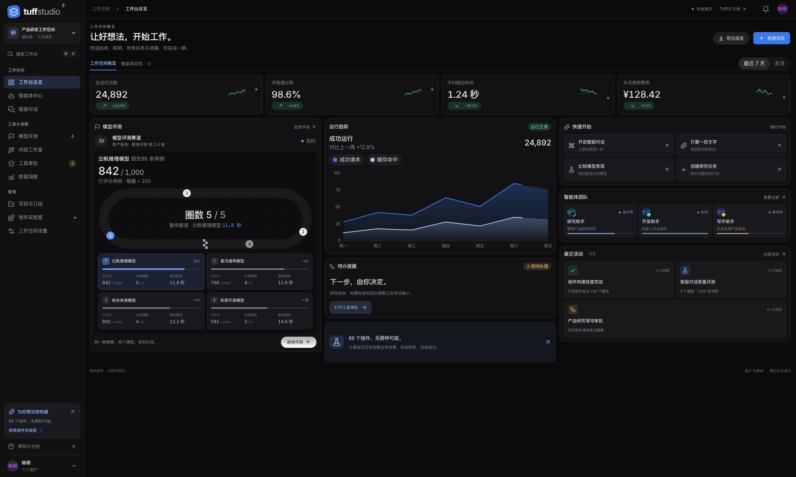
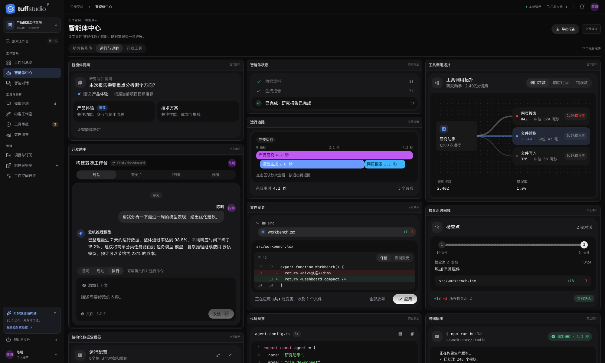
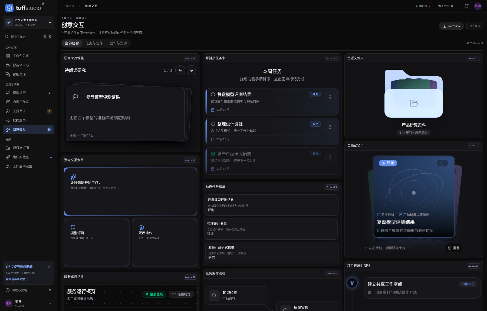
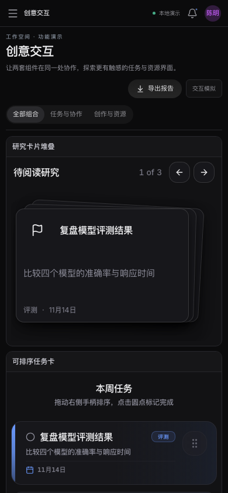

# Tuff Studio

一个中文、黑色主题的静态 AI 工作台，整合 **TuffUI 的 86 个组件**与 **AvaraUI 的 28 个组件**，通过 11 个功能页面展示组件在实际界面中的组合方式。

左侧导航，右侧内容；紧凑的 Bento 卡片布局，让模型评测、智能体运行、内容创作与团队协作集中在同一个工作空间。



## 界面亮点

- **紧凑卡片布局**：根据卡片高度分配到较短的列，减少参差卡片之间的空洞；宽屏多列，手机单列。
- **统一中文体验**：导航、交互提示和业务演示数据使用中文，配合黑色背景与蓝色强调色。
- **114 个组件预览**：组件实验室支持组件库筛选、分类、关键词搜索和展开全部预览。
- **可操作的静态演示**：体验对话、模型评测、审批、任务卡、资源文件夹、弹窗与通知等交互。
- **快捷导航与导出**：使用 `⌘ / Ctrl + K` 搜索页面和组件，导出本地 JSON 演示报告。
- **开箱即用**：无需登录、后端服务或环境变量；交互与数据均在本地演示，不调用真实 AI 服务。

## 界面展示

### 智能体中心

将智能体提问、运行状态、调用拓扑、执行追踪、文件变更与检查点组合为紧凑的工作界面。



### 创意交互

将 AvaraUI 的卡片堆叠、可排序任务、资源文件夹、灵感记忆卡与时间线融入同一套工作台样式。



### 移动端

小屏幕使用单列卡片和可展开导航，保留页面筛选与交互入口。



## 页面一览

| 页面         | 路由           | 展示内容                                     |
| ------------ | -------------- | -------------------------------------------- |
| 工作台总览   | `/`            | 核心指标、运行趋势、模型评测、团队与近期动态 |
| 智能体中心   | `/agents`      | 智能体状态、工具调用、执行追踪与开发辅助     |
| 智能对话     | `/chat`        | 消息流、会话列表、引用来源与附件             |
| 模型评测     | `/evaluations` | 模型竞赛、评测结果与对比可视化               |
| 内容工作室   | `/writer`      | 写作、语气改写与内容预览                     |
| 工具审批     | `/approvals`   | 调用审批、风险提示与权限管理演示             |
| 数据洞察     | `/analytics`   | 用量、费用、趋势与分布图表                   |
| 项目与订阅   | `/projects`    | 项目资源、订阅与业务场景卡片                 |
| 创意交互     | `/creative`    | AvaraUI 的 28 个组件组合演示                 |
| 组件实验室   | `/components`  | 114 个组件的分类、搜索与独立预览             |
| 工作空间设置 | `/settings`    | 偏好、表单与配置类交互                       |

另保留公开访问的 `/about` 页面与未匹配路径的 404 页面。

## 本地运行

推荐使用 Node.js 24 与 npm 11。

```sh
git clone https://github.com/MrLucy/tuffui-template.git
cd tuffui-template
npm ci
npm run dev
```

打开 [http://localhost:5180](http://localhost:5180)。

```sh
npm run build    # 类型检查并生成 dist/
npm run preview  # 预览生产构建
npm test         # 公开路由与全部组件预览测试
```

部署时将 `dist/` 作为静态目录，并将非静态资源路径回退到 `index.html`，以支持直接打开子路由。

## 技术与目录

基于 React、TypeScript、Vite、Tailwind CSS v4、React Router、Radix UI 与 Motion 构建。

```text
src/
  features/studio/   # 功能页面、组件演示、目录与紧凑布局
  components/ui/    # TuffUI 与基础 UI 组件
  components/avara/ # AvaraUI 组件、来源记录与许可说明
  layouts/          # 侧边栏、顶栏与页面容器
  router/           # 公开路由配置
  pages/            # 关于页与 404 页面
  lib/              # 通用工具
docs/images/        # README 展示截图（选自 artifacts/）
```

## 组件来源

感谢 [TuffUI](https://tuffui.com/components/eval-race) 与 [AvaraUI](https://avaraui.com/docs/nextjs/all-components) 提供组件与设计参考。

组件保留各自的版权与许可信息；AvaraUI 的来源及本地适配说明见 [组件说明](src/components/avara/README.md)与[来源记录](src/components/avara/sources.json)。
